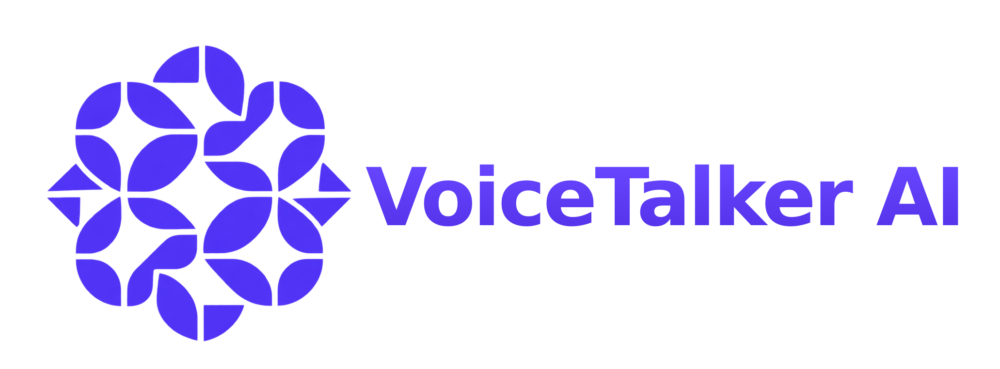

<p align="center"></p>

# BYOLLM: VoiceTalker Agent Skills

### Bring your own LLM. Turn any document, brief, app or video into a finished, voiced VoiceTalker Scribe.

**[Open the VoiceTalker Agent Skills app](https://cmwrx.github.io/BYOLLM/)** · **[Download the latest release](https://github.com/cmwrx/BYOLLM/releases/latest)** · **[Sign up for VoiceTalker, free](https://voicetalker.ai/sign-up)**

VoiceTalker Agent Skills are 17 agent skills and a menu that work in the AI agent you already use: Claude, ChatGPT, Codex, Gemini, Grok, Copilot or any other LLM. Your agent writes the Scribe (scenes, short clips, a voice for every speaker, a media plan, sound and pictures); VoiceTalker Studio voices it, illustrates it and records it as MP3 or MP4. Every skill saves a new file and never overwrites yours.

Skill set 3.2.8 for VoiceTalker 1.08, from Centerbeam AI.

## The app

The [VoiceTalker Agent Skills app](https://cmwrx.github.io/BYOLLM/) is the fastest way in. It runs in your browser, keeps its settings in your browser, and never reads your files.

1. **BYOLLM Setup:** install steps for each agent, and roles: Agent 1 writes, Agent 2 reviews.
2. **Home:** tell it what you have; it opens the right skill, builds the prompt in your agent's own call style, and keeps your run order.
3. **Scenarios:** 17 step-by-step routes, drawn as diagrams; load one into your run order.
4. **Codeumentation™:** code and documentation as one deliverable.
5. **Help:** the full VoiceTalker flow, from your AI agent to a recorded episode.

The same app ships inside the plugin at `app/index.html`.

## Install

### Claude Code

```bash
claude plugin marketplace add cmwrx/BYOLLM
claude plugin install voicetalker-skills@byollm
```

Then start a new session and type `/voicetalker-skills:menu`.

### Claude desktop app and claude.ai

Download `voicetalker-skills.plugin` from the [latest release](https://github.com/cmwrx/BYOLLM/releases/latest) and open it; the app installs it in one step.

### Codex

```bash
codex plugin marketplace add cmwrx/BYOLLM
```

Then install VoiceTalker Skills from the BYOLLM marketplace in the plugin directory, restart Codex, and call `$menu`.

### Grok Build and other agents that read skill folders

Copy the skill folders into the agent's skills folder:

```bash
git clone https://github.com/cmwrx/BYOLLM.git
cp -R BYOLLM/plugins/voicetalker-skills/skills/* ~/.agents/skills/     # Grok Build reads this folder (so does Codex)
```

Restart the agent, then call `/menu` (Grok Build) or `$menu` (Codex).

### ChatGPT, Gemini, Copilot and others

Add the `SKILL.md` files to a project, Gem or workspace, and start each step with: *Follow the instructions in scribe/SKILL.md exactly.* The app's BYOLLM Setup page has the steps for each.

### From a downloaded copy of this repository

Download the repository (Code, Download ZIP) and unzip it, or `git clone https://github.com/cmwrx/BYOLLM.git`. Then, with the folder's path in place of `BYOLLM`:

1. **The app:** open `BYOLLM/docs/index.html` in your browser; it works straight from the folder.
2. **Claude Code:** `claude plugin marketplace add ./BYOLLM`, then `claude plugin install voicetalker-skills@byollm`.
3. **Codex:** `codex plugin marketplace add ./BYOLLM`, then install VoiceTalker Skills from the plugin directory.
4. **Claude desktop app:** make the one-click file and open it:
   `cd BYOLLM/plugins/voicetalker-skills && zip -qr ~/Desktop/voicetalker-skills.plugin . -x "*.DS_Store" && open ~/Desktop/voicetalker-skills.plugin`

Install the plugin or loose skill folders, never both, or every skill appears twice.

Check that it worked: start a new chat and ask *"What skills do you have for VoiceTalker?"* All 17 skills and the menu appear. The full guide, with requirements, every skill, all scenarios and troubleshooting, is [plugins/voicetalker-skills/README.md](plugins/voicetalker-skills/README.md).

## The skills

1. **Basic (no Python):** `scribe-wizard`, `comic-strip`, `existing-images`, `characters`, `scribe`, `scribe-reviewer`.
2. **Pictures and media (Python 3.8+):** `image-manifest`, `merge-media`, `gen-svg`, `gen-gpt-images`, `gen-frames-manifest`.
3. **Capture a real app (Python, Chrome, Pillow):** `screen-cap`, `screen-cap-video`.
4. **Video into a Scribe:** `videotalker-import`.
5. **Sound and music (subagent):** `soundscape`.
6. **Critique and repair (subagent):** `film-critic`, with the Siskel & Ebert style balcony review.
7. **Maintain:** `codeumentation`.
8. **The launcher:** `menu`.

## VoiceTalker account

The skills write the Scribe; [VoiceTalker Studio](https://voicetalker.ai) turns it into a finished episode. Start on the Free plan at [voicetalker.ai/sign-up](https://voicetalker.ai/sign-up).

## Repository layout

```
.claude-plugin/marketplace.json   the Claude Code marketplace (byollm)
.agents/plugins/marketplace.json  the Codex marketplace (byollm)
plugins/voicetalker-skills/       the plugin: skills/, the manifests, assets/, app/, README.md, INSTALL.txt
docs/                             the app, served by GitHub Pages
tools/check.py                    the checks run on every push
LICENSE.txt                       the VoiceTalker Plugins and Skills License
```

## Contributing, security and license

See [CONTRIBUTING.md](CONTRIBUTING.md), [SECURITY.md](SECURITY.md) and [CODE_OF_CONDUCT.md](CODE_OF_CONDUCT.md). Released under the VoiceTalker Plugins and Skills License 1.0 ([LICENSE.txt](LICENSE.txt)). VoiceTalker and Codeumentation are trademarks of Cloud Media Works LLC d/b/a Centerbeam AI; the license grants no trademark rights.

© 2026 Centerbeam AI · [centerbeam.ai](https://centerbeam.ai) · [voicetalker.ai](https://voicetalker.ai)
