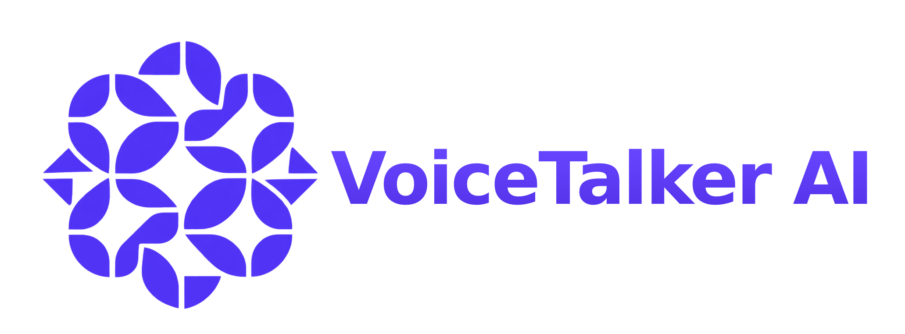

<p align="center"></p>

# VoiceTalker Skills
### Turn any document, brief, app or generated video into a finished, ready-to-record VoiceTalker Scribe

(C) 2026 Centerbeam AI. Skill set v3.2.8 for VoiceTalker 1.08 (Scribe file format 1.06.7). Updated November 26, 2026.
D.Anderson - Centerbeam.ai

Give an AI assistant a **text, Markdown, Word, PDF, PowerPoint or JSON** file, or a short brief. Get back a complete **VoiceTalker Scribe**: scenes and short clips, a different voice for every speaker, brisk delivery, a title card, a closing card, and ready-to-generate pictures with characters that look the same in every shot. The same skills also capture a real app as screen shots or screen video, and put videos made in VideoTalker onto the right clips.

Every skill saves a **new file** and tells you its full path. None changes a file you gave it. The skills that run Python check their own work and show `RESULT PASS` or `FAIL`.

---

## Before you start: Python 3 is required for some of these skills

**Eight of the 18 skills run Python scripts on your computer to check their own work and to merge files. Without Python 3 they still write their files, but they cannot check them, and every `RESULT` line is then unverified.**

| What you need | Version | Which skills need it |
|---|---|---|
| **Python 3** (the command `python3`) | **3.8 or later** | `image-manifest`, `merge-media`, `videotalker-import`, `gen-svg`, `gen-gpt-images`, `gen-frames-manifest`, `screen-cap`, `screen-cap-video` |
| Nothing (no Python) | | `scribe-wizard`, `comic-strip`, `existing-images`, `characters`, `scribe`, `scribe-reviewer` (it runs its own check script when Python is there, and checks by reading when it is not), `film-critic`, `soundscape`, `codeumentation`, `menu` |
| Python package **Pillow** (the picture library; `python3 -m pip install Pillow`, see below), **Google Chrome** | | `screen-cap`, `screen-cap-video` |
| **ffmpeg** | | `screen-cap-video` (and `ffprobe`, which comes with it, is used by `videotalker-import` when it is there); `film-critic` uses it to review a recorded video (or give it a transcript and stills) |

All the other Python scripts use only what comes with Python (no `pip install`).

**Check that you have it.** Open a terminal and type:

```bash
python3 --version
```

It must print `Python 3.8` or higher (for example `Python 3.12.4`). If it says "command not found", or prints `Python 2.7`, install Python 3:

- **macOS:** `brew install python`, or the installer from python.org.
- **Windows:** the installer from python.org (tick "Add python.exe to PATH"). The skills call `python3`; if your terminal only knows `python` or `py`, use WSL (Windows Subsystem for Linux), or make `python3` work before you start.
- **Linux:** `sudo apt install python3` (or your package manager's equivalent).

### Only for the screen-capture skills: Pillow, Google Chrome and ffmpeg

`screen-cap` and `screen-cap-video` need three more things on the computer where your assistant runs its commands. The other skills need none of them.

| What | What it is | Check | Install |
|---|---|---|---|
| **Pillow** | A free Python library for pictures. The screen-capture scripts use it to open each screen shot, crop it tight around the parts the clip names, and save it at exactly 1920 x 1080. It is not part of Python itself, so it is installed once, separately | `python3 -c "import PIL; print(PIL.__version__)"` prints a version number | `python3 -m pip install Pillow` |
| **Google Chrome** | The browser the skills open, in a separate window, to take the shots | Chrome is in your Applications (macOS) or Start menu (Windows) | from google.com/chrome |
| **ffmpeg** (with `ffprobe`) | The video tool that encodes the screen videos (`screen-cap-video`) and reads video lengths (`videotalker-import`, when it is there) | `ffmpeg -version` | macOS `brew install ffmpeg`; Windows and Linux from ffmpeg.org or your package manager |

If `pip install` stops with "externally-managed-environment" (Homebrew's Python on macOS, some Linux systems), use `python3 -m pip install --user Pillow`, or on macOS `brew install pillow`. If Pillow is missing when a screen-capture script runs, the script stops with a one-line message naming Pillow and the install command.

**Where it must be.** Python runs on the computer where your AI assistant runs its commands: Claude Code and Codex use your own computer. A chat window that cannot run commands (a plain chat) cannot run the check scripts, and the two screen-cap skills need your own computer with Chrome. If you have no Python, see Scenario 12.

---

## 0. The media pipeline (v3.0): words, plan, shots, merge, load

Every kind of media is **optional, per scene and per clip, in any mix**: a generated picture, a screen shot of any web app, your own picture, SVG, mp3 or mp4, a screen video, or nothing. A picture or video may run on across clips and scenes. **All media is tied to the words of the clip that speaks it.**

```
 1 characters (optional) --> 2 scribe (the words, no pictures) --> 3 image-manifest (THE MEDIA PLAN)
      --> 4 screen-cap (shots, checked one at a time)  and  screen-cap-video (screen videos)
      --> 5 merge-media (one merge for everything) --> 6 open in VoiceTalker: Load picture or video, Batch Media, save
```

- **Step 3 is the plan.** It lists, for every scene and clip, what it shows or `none`. You can give indexed assignments (`clip 3 = screen shot`), rules (`every 3rd clip`, `every named button`, `every key object`, `every scene`, titles, intro, outro, interstitials), or accept what it proposes. The plan lives in one internal file that the skills write and read; **you only ever open the Scribe.**
- **Step 4 works on any web app or site you open.** Each screen shot lists the labels its clip speaks about (`mustShow`). The skill finds them on the live page, crops tight, and proves by geometry that every one is inside the picture before showing it. It then asks you about that shot (keep, retake, point at another part, none) before the next one. Nothing is decided silently.
- **Step 5 is one merge**: `merge-media` replaces `merge-images` and `merge-videos`, which are no longer in the skill set; it also reads the cut sheets they read. It never writes a placeholder or an unapproved shot, never replaces a generated picture without asking, and warns when a video and the narration under it differ in length.
- **Every step is re-entrant, for one item or all.** Edit a clip's words, then `plan_repair.py sync` marks only the shots whose words changed as stale; `cdpcap.py queue` / `retake` / `status` retake one shot, a few, or everything not yet approved (approved shots are never retaken unless named); `merge-media` writes nothing and raises no version when nothing changed. A plan is never rebuilt to fix one entry.
- In VoiceTalker, the camera move now runs **across** the clips that share a picture (one push-in, no restart at every clip).

## 1. The complete set (17 skills, a menu and the app)

Not sure which to run? Type `/menu` (`/voicetalker-skills:menu` in the plugin, `$menu` in Codex): it shows a numbered menu of every skill, asks for the parameters of the one you pick, and runs it.

```
 THE MAIN LINE (any text becomes a finished, illustrated Scribe)

   your file --> 1 characters --> 2 scribe --> 3 image-manifest --> 4 screen-cap(-video) --> 5 merge-media --> 6 open in VoiceTalker
                 (optional)       the words     the MEDIA PLAN       the shots (optional)   one merge          Load, Batch Media

 OTHER WAYS TO MAKE THE SCRIBE (they replace steps 0 and 1; steps 2 and 3 still apply)

   brief or goals file --> scribe-wizard          (fast, 1 to 3 speakers, minimal)
   panel script        --> comic-strip            (numbered comic panels)
   your own pictures   --> existing-images        (place photos and screen shots, no new art)

 ADD-ONS (any time, on a Scribe that exists)

   gen-svg ............ animated SVG pictures you upload as backgrounds
   gen-gpt-images ..... a ChatGPT prompt set (JPG, indexed, with key frames to attach) from the media plan
   gen-frames-manifest  matched flipbook frames or single-frame holds, with optional speech-bubble planning
   screen-cap ......... real, zoomed screen shots of a running app
   screen-cap-video ... MP4 of a running app with zoom, pan and highlights, timed to the narration,
                                     and the video cut sheet that merge-media reads
   soundscape ......... a subagent sound designer: a full soundscape plan (ambience, foley, effects,
                                     music, silence, fades) for a Scribe or a sound brief

 REVIEW (any time, on a Scribe, a video or a brief; changes nothing unless you ask)

   scribe-reviewer .... code-review a Scribe: ranked defects, fixes only when asked
   film-critic ........ video-critique subagent: critique a Scribe, recorded video, screenplay or video
                                     brief; Siskel & Ebert style balcony review with thumbs and an edit score;
                                     the review-and-repair loop until you are satisfied

 MAINTAIN

   codeumentation ..... Codeumentation(tm): bring the code and every doc a change touches up to date

 THE APP

   app/index.html ..... the VoiceTalker Agent Skills app: the menu, BYOLLM setup and scenarios in a browser

 VIDEO INTO A SCRIBE

   VideoTalker scene list --> videotalker-import --+
   screen videos of an app --> screen-cap-video ---+--> merge-media --> Scribe with a video on each scene's clips
   (any video cut sheet in the same format) -------+
```

| Skill (folder name) | Role | Takes | Saves | Version |
|---|---|---|---|---|
| `characters` | Step 0 (optional): the cast. Voices, delivery, looks, staging | text, Markdown, Word, PDF, PowerPoint, JSON | `<project>-cast.md` | 3.2.8 |
| `scribe` | Step 1: the words. Scenes, clips, voices, INTRO/OUTRO if wanted | the same files, optionally the cast file | `<project>-scribe-v1.00.json` | 3.2.8 |
| `image-manifest` | Step 3: the media plan for every scene and clip (generated, screen shot, upload, video, placeholder, none) and the final picture prompts | Scribe (and cast file) | `<project>-image-manifest.md` | 3.2.8 |
| `merge-media` | Step 5: ONE merge of every kind of media from the plan into the Scribe (replaces merge-images and merge-videos) | Scribe and the manifest | `<project>-scribe-v1.NN.json` | 3.2.8 |
| `scribe-wizard` | Alternative to steps 0 and 1: a short questionnaire, 1 to 3 actors | a brief or goals file | a complete Scribe, optional small image manifest | 3.2.8 |
| `comic-strip` | Alternative to step 1 for comics: strict panel order, intro and outro | a panel script or an idea | a complete comic Scribe | 3.2.8 |
| `existing-images` | Places pictures you already have (photos, scans, screen shots) without making new ones | your images and a Scribe | an image-to-clip plan, import hand-off | 3.2.8 |
| `gen-svg` | Animated SVG pictures of people, places, things, scenes and title cards | cast, Scribe, manifest, your pictures or a description | `<object>-<type>.svg` files and `<project>-svg-list.md` | 3.2.8 |
| `gen-gpt-images` | Optional, after step 3: an indexed prompt set for making the plan's pictures in ChatGPT, one conversation, with the key frames to attach so every character and place looks the same | the media plan (manifest), optional cast file | `<project>-chatgpt-prompts.json` | 3.2.8 |
| `gen-frames-manifest` | Optional flipbook. Use three matched frames by default, or choose single-frame holds and timed cuts. Keeps broadcast slots and continuous clip audio. Type `n` for the next clip. | Scribe or frames manifest, optional pictures | Versioned frames manifest, any generated images, and a versioned Scribe when native handoff is requested | 3.2.8 |
| `screen-cap` | Step 4: screen shots of any web app, each tied to the words of its clip, proved to show the named parts, and confirmed with you one shot at a time | The media plan (manifest), the Scribe, and the page's address | PNG files (1920x1080) and the manifest updated | 3.2.8 |
| `screen-cap-video` | Screen video of a live app, timed to the narration; also writes the video cut sheet | Scribe and the app's address | MP4 files, `<project>-video-plan.md` and `<project>-video-manifest.md` | 3.2.8 |
| `videotalker-import` | Turns a VideoTalker scene list into a media cut sheet (`vt-video-manifest.v1`), one cut per scene on its first clip | VideoTalker `video-scene.json` and a Scribe | `<project>-video-manifest.md` | 3.2.8 |
| `scribe-reviewer` | Review: checks a Scribe against the rules of `scribe` 3.2.8 and `merge-media` the way a code review checks code (schema and 1.06.7 keys, IDs and order, 45-word clips, voices and providers, one voice per speaker, inline tags, prosody, pictures and `file:` paths, source coverage), verifies each finding and ranks them most severe first. Changes nothing unless you ask for fixes. Run it in a fresh session, not the one that wrote the Scribe | a Scribe; optional source file, earlier version, effort level | a review report (READY, READY WITH NITS or NEEDS FIXES); the next Scribe version only on a fix pass | 3.2.8 |
| `soundscape` | Optional, any time: runs as a subagent sound designer. Critiques the sound of a Scribe or a sound brief and plans a full soundscape (layered ambience, foley, effects, music and silence, with volume, start, length and fades) at the Scribe's positions (S3C1F1) or the brief's cues, with a generation prompt for every new sound. Never changes a sound already there | a Scribe or a sound brief: file, URL, paste or the current session (default); optional run timings | the plan in chat; on request, the next Scribe version with only the added sounds as `file:` paths | 3.2.8 |
| `film-critic` | Review: runs as a video-critique subagent. A journalistic critique, or a Siskel & Ebert style balcony review (two invented critics, thumbs up or down, 1-to-10 scores and a final edit score 0 to 100), or the review-and-repair loop: critique, the owner approves changes, agent 2 (or the subagent, asking each time) makes them, review again, until the owner is satisfied | a Scribe, recorded video, screenplay or video brief: file, URL, paste or the current session (default) | the critique or review in chat; on approved repairs, the next version | 3.2.8 |
| `codeumentation` | Maintain: Codeumentation(tm), code and documentation as one. Updates every code and doc file a change touches in one pass, then an independent subagent checks for gaps | the change (this chat by default), a file, a URL or pasted text | the updated files and a report | 3.2.8 |
| `menu` | A numbered ASCII menu of all the skills in two sections, Basic (no Python) and Advanced (Python 3.8 or later), drawn in colour where the host can draw an inline visual (the Claude app, claude.ai: a box on desktop, a stacked list on a phone, tap a row to choose) and as plain text everywhere else (a wide box, or a 40-column compact list on a phone; `menu wide` and `menu compact` switch); `?` shows the usage patterns, and each skill's pattern is shown when you pick it; asks for the parameters of the one you pick, then runs it | your pick | nothing itself; the chosen skill saves its own file | 3.2.8 |

The versions are the `version:` line at the top of each `SKILL.md`. All skills share one version, the skill set version (3.2.8), and the plugin has the same version. The menu shows the same number in its header (`skill set v3.2.8`, in the wide box, the compact list and the usage view); change it there too when the version changes.

### The VoiceTalker Agent Skills app

`app/index.html` is the same set as a page: open it in any browser (no install, no server), or use it online at https://cmwrx.github.io/BYOLLM/. Its layout: a rail with the menu and the skills tree, a header, a slim promotion banner, the work area and a footer.

- **Home:** skill group, project folder and Scribe stage; "What do you have?" opens the right skill; each skill's fields build the prompt in your agent's own call style (`/voicetalker-skills:scribe`, `$scribe`, `@scribe`, or plain instructions); copy it or open the agent with it; a run order you add to, reorder and tick off.
- **BYOLLM Setup:** install steps for Claude, ChatGPT, Codex, Gemini, Grok and Copilot, or any other LLM you add; mark each installed; choose Agent 1 (writes) and Agent 2 (reviews). Writing skills go to Agent 1, review skills to Agent 2.
- **Scenarios:** every scenario of section 6 as a diagram; load one into the run order.
- **Codeumentation(tm)** and **Help**: the full VoiceTalker flow, from your AI agent to a recorded episode.
- Everything on the page comes from `app/agent-skills.json`: the skills, the menu tree, the scenarios, the agents and the banner. Settings stay in your browser; the page never reads your files.

### Which one do I start with?

| You have | Start with |
|---|---|
| A document, story, lesson or script of any length | `scribe` (add `characters` first if there are several speakers or a series) |
| A few lines of idea: topic, speakers, mood | `scribe-wizard` |
| A comic script | `comic-strip` |
| Pictures you already own that must appear as they are | `existing-images` |
| A finished Scribe about a real app | `screen-cap` (stills) or `screen-cap-video` (video, then `merge-media`) |
| A VideoTalker project with generated scene videos | `videotalker-import`, then `merge-media` |
| A Scribe you want checked before you use it | `scribe-reviewer`, in a fresh session (add the source file to check that nothing was dropped) |
| A Scribe, recorded video, screenplay or video brief you want critiqued as a story | `film-critic` (menu 16; 16B for the Siskel & Ebert style review with thumbs and an edit score). For critique, repair and review again until you are satisfied, scenario 15 |
| A Scribe or a sound brief that needs fuller, professional sound | `soundscape` (menu 15) |
| A change you made that every guide, menu and package must reflect | `codeumentation` (menu 17) |
| A Scribe with a flipbook of timed stills and holds | `gen-frames-manifest` |
| A Scribe and videos you made another way | write the cut sheet by hand (format in `merge-media`), then `merge-media` |

---

### What each skill accepts

The numbers are the menu numbers. `no` means the skill does not say it reads that kind of input: give it a file.

| # | Skill | File | URL | Pasted text | Current conversation |
|---|---|---|---|---|---|
| 1 | `scribe-wizard` | brief or goals `.md` | no | the brief or goals | yes: describe it in answers to its questions |
| 2 | `comic-strip` | panel script; cast file | no | the panel script or a comic idea | no |
| 3 | `existing-images` | Scribe `.json`; the pictures (a folder or a picture list) | no | the list of picture paths | no |
| 4 | `characters` | text, Markdown, Word, PDF, PowerPoint or JSON; an earlier cast file | no | no | no |
| 5 | `scribe` | text, Markdown, Word, PDF, PowerPoint or JSON; cast file | no | no | no |
| 6 | `scribe-reviewer` | Scribe `.json`; source; an earlier version | no | the Scribe JSON | no |
| 7 | `image-manifest` | Scribe `.json`; cast file; your own media files | no | no | no |
| 8 | `merge-media` | Scribe `.json`; media plan or media cut sheet | no | no | no |
| 9 | `gen-svg` | cast file, Scribe, image manifest or your pictures | no | a written description | no |
| 10 | `gen-gpt-images` | image manifest `.md`; cast file | no | no | no |
| 11 | `gen-frames-manifest` | Scribe `.json` or a frames manifest; your images | no | no | no |
| 12 | `screen-cap` | image manifest `.md`; the Scribe | the page to capture | no | no |
| 13 | `screen-cap-video` | Scribe `.json`; video plan or shot list; a completed run | the app address and port | no | no |
| 14 | `videotalker-import` | VideoTalker scene list `.json`; Scribe `.json`; the scene videos | no | no | no |
| 15 | `soundscape` | Scribe `.json` or a sound brief (`.md`, `.txt`, `.docx`, `.pdf`); run timings | a Scribe JSON or a brief | the Scribe JSON or the brief | yes (the default): the Scribe or brief already in this chat |
| 16, 16B | `film-critic` | Scribe `.json`, recorded video, screenplay or video brief; run timings; an earlier version | a Scribe, a brief or a page (a video link only if the host can download it) | the Scribe JSON, a script or the brief | yes (the default): the Scribe, video or brief already in this chat |
| 17 | `codeumentation` | notes, a diff or a spec of the change; the project folder | a spec or an issue page | a description of the change | yes (the default): the changes made in this chat |

### Usage patterns

The same parameters, written the way command-line usage is written. In the menu, type `?` to see this view (in colour where the host can draw it, as a 40-column list on a phone); after you pick a number, the menu shows that skill's lines first.

```
+==============================================================================+
|                     V O I C E T A L K E R   S K I L L S                      |
|                Centerbeam AI  -  skill set v3.2.8  -  VT 1.08                |
|                                  U S A G E                                   |
+==============================================================================+
|                                                                              |
|  <x> required   [x] optional   a|b one of   x... one or more                 |
|  file.json a file   url a web address   "text" pasted   chat this chat       |
|  source = .txt .md .docx .pdf .pptx .json                                    |
|                                                                              |
|  BASIC  (no Python needed)                                                   |
|   1  scribe-wizard     short brief, 1 to 3 speakers  ->  Scribe JSON         |
|        <brief.md|"text"|chat> [out/]                                         |
|   2  comic-strip       panel script  ->  comic Scribe JSON                   |
|        <script.md|"idea"> [cast.md]                                          |
|   3  existing-images   place pictures you already own                        |
|        <scribe.json> <pics/|"paths"> [16:9|9:16]                             |
|   4  characters        cast: voices, delivery, looks (optional)              |
|        <source> [cast.md]                                                    |
|   5  scribe            document or story  ->  Scribe JSON                    |
|        <source> [cast.md]                                                    |
|   6  scribe-reviewer   review a Scribe: ranked defects, read-only            |
|        <scribe.json|"json"> [source] [old.json] [low|medium|high|max]        |
|                                                                              |
|  ADVANCED  (Python 3.8 or later required: python3 --version)                 |
|   ADD PICTURES AND MEDIA                                                     |
|   7  image-manifest    plan the MEDIA for every scene and clip, any mix      |
|        <scribe.json> [cast.md] [media...]                                    |
|   8  merge-media       ONE merge: plan -> pictures, shots, videos, none      |
|        <scribe.json> <plan.md|cuts.json>                                     |
|   9  gen-svg           animated SVG pictures                                 |
|        <cast|scribe|plan|pics|"text">... [out/]                              |
|  10  gen-gpt-images    ChatGPT prompt set (JPG) from the media plan          |
|        <plan.md> [pics...] [jpg|png] [cast.md]                               |
|  11  gen-frames        timed flipbook frames and single-frame holds          |
|        <scribe.json|frames.json> [pics...] [16:9|9:16|1:1]                   |
|        [frames=3] [bubbles=on|off]                                           |
|   CAPTURE A REAL APP  (also needs Google Chrome and Pillow)                  |
|  12  screen-cap        screen shots of the plan, checked shot by shot        |
|        <plan.md> <scribe.json> <url> [out/]                                  |
|  13  screen-cap-video  screen video + the media cut sheet (also ffmpeg)      |
|        <scribe.json> <url:port> [shots.md] [run.json]                        |
|   VIDEO INTO A SCRIBE                                                        |
|  14  videotalker-import  VideoTalker scene list  ->  media cut sheet         |
|        <scenes.json> <scribe.json> [videos/]                                 |
|   SOUND AND MUSIC                                                            |
|  15  soundscape        subagent sound design: Scribe or brief -> plan        |
|        [scribe.json|brief.md|url|"text"|chat] [run.txt] [audio/] [apply]     |
|   CRITIQUE AND REPAIR                                                        |
|  16  film-critic       subagent video critique: Scribe, video or brief       |
|        [scribe.json|video.mp4|brief.md|url|"text"|chat] [critique|loop]      |
|        [run.txt] [old] [notes] [agent2|subagent]                             |
|  16B   balcony review  Siskel & Ebert style: thumbs + edit score             |
|        same source as 16, mode balcony                                       |
|   MAINTAIN                                                                   |
|  17  codeumentation    code + every doc a change touches, one pass           |
|        [change.md|url|"text"|chat] [root/] [apply|list] [version]            |
|                                                                              |
|   S  scenarios   ?  usage   0  exit                                          |
|                                                                              |
+------------------------------------------------------------------------------+
|  Any order. Any number of times. Every skill saves a NEW file.               |
+==============================================================================+
```

## 2. Install, portable

You need the skill folders that sit next to this README. **Always copy whole folders**: some hold more than `SKILL.md` (`image-manifest` has `check_drift.py` and `check_plan.py`; `screen-cap` has `cdpcap.py`; `screen-cap-video` has `cdpvideo.py`; `merge-media`, `videotalker-import` and `gen-gpt-images` have a `scripts` folder; `gen-frames-manifest` has `scripts`, `references` and `.codex-plugin` folders).

| Needs | For |
|---|---|
| `python3` (3.8 or later); see "Before you start" above for the check and the install | eight skills: `image-manifest`, `merge-media`, `videotalker-import`, `gen-svg`, `gen-gpt-images`, `gen-frames-manifest`, `screen-cap`, `screen-cap-video`. The remaining skills need no Python (`scribe-reviewer` uses it when available). |
| Google Chrome and the Python package Pillow, the picture library (`python3 -m pip install Pillow`; check with `python3 -c "import PIL; print(PIL.__version__)"`) | `screen-cap`, `screen-cap-video` |
| `ffmpeg` and `ffprobe` (macOS: `brew install ffmpeg`) | `screen-cap-video`; `videotalker-import` uses `ffprobe` for real video lengths when it is there |
| `screen-cap` installed beside it | `screen-cap-video` (it uses that skill's browser driver; install both together) |
| `pandoc`, `pdftotext` or `python-pptx` | reading Word, PDF or PowerPoint files (optional; any one that fits your input) |

Open a terminal in the folder that holds this README (in the VoiceTalker project, `docs/VOICETALKERS/SKILLS`).

**One portable installer for any agent.** Set `DEST` to the agent's skills folder and run it. It copies every skill folder (each folder here that holds a `SKILL.md`) whole, skips Python caches, and can be run again at any time to update.

```bash
cd docs/VOICETALKERS/SKILLS
DEST=~/.claude/skills          # Claude Code, all projects
# DEST=<your-project>/.claude/skills   # Claude Code, one project
# DEST=~/.agents/skills                # Codex, all projects
# DEST=<your-project>/.agents/skills   # Codex, one project
mkdir -p "$DEST"
for f in */SKILL.md; do s=${f%/SKILL.md}; rsync -a --delete --exclude __pycache__ "$s/" "$DEST/$s/"; done
```

No `rsync`? Use `rm -rf "$DEST/$s" && cp -R "$s" "$DEST/"` inside the same loop.

**Updating to the short names:** the skills were renamed without the `voicetalker-` prefix (`voicetalker-scribe` is now `scribe`, `voicetalker-menu` is now `menu`). The loop above does not remove the old folders, so remove them from the agent's skills folder, or every skill appears twice: `rm -rf "$DEST"/voicetalker-*`. On claude.ai, delete the old `voicetalker-...` skills under Settings, Capabilities, Skills, or install the plugin instead.

**Updating from 3.2.4 or earlier:** `merge-images` and `merge-videos` are no longer in the set (`merge-media` does both). The loop above does not remove them, so remove them from the agent's skills folder: `rm -rf "$DEST/merge-images" "$DEST/merge-videos"`. On claude.ai, delete those two skills under Settings, Capabilities, Skills.

Check that the copies match the originals (it must print nothing):

```bash
for f in */SKILL.md; do s=${f%/SKILL.md}; diff -rq --exclude __pycache__ "$s" "$DEST/$s"; done
```

### As one plugin (portable manifest)
The same skills also come as one plugin, `voicetalker-skills` 3.2.8 (the skill set version): the file `voicetalker-skills-v3.2.8.zip` in this folder, and the website download `carousel/VoiceTalker-Skills.zip`. Unzipped, it looks like this:

```
voicetalker-skills/
  README.md                   this guide (the menu reads its install steps and scenarios from it)
  plugin.json                 portable manifest ($schema https://agent-plugins.org/schemas/1.0.0/plugin.schema.json)
  .claude-plugin/plugin.json  Claude Code manifest
  .claude-plugin/icon.png     the plugin icon, copied from assets/voicetalker-ai-icon.png
  .codex-plugin/plugin.json   Codex compatibility manifest ("skills": "./skills/", display details)
  skills/
    scribe/SKILL.md
    menu/SKILL.md
    ... all included skill folders, whole, with their scripts
  assets/
    voicetalker-ai-logo.png           the VoiceTalker AI logo (2063x762)
    voicetalker-ai-logo-animated.svg  the same logo, animated
    voicetalker-ai-icon-48.png        the 48x48 icon
    voicetalker-ai-icon.png           the square plugin icon (1024x1024): the logo mark alone
  app/
    index.html                        the VoiceTalker Agent Skills app: open it in a browser
    agent-skills.json                 its data: skills, menu tree, scenarios, agents, banner
    assets/                           the VoiceTalker logos and the steampunk artwork
```

All three manifests share one name, version and description, and every host finds the skills in `skills/`: the portable format and Claude Code look there by default, and the Codex manifest names it. Codex reads `.codex-plugin/plugin.json` because `plugin.json` has no `extensions.com.openai`; it shows the 48x48 icon (`composerIcon`), the square 1024x1024 icon as the plugin logo (`logo`), the brand colour `#5033F5` from `assets/`, three starter prompts (`defaultPrompt`) as cards on the plugin's page, and the privacy and terms links (`privacyPolicyURL`, `termsOfServiceURL`) from voicetalker.ai. The page with the logo, colour and prompt cards appears only for a plugin published in the ChatGPT/Codex plugin directory. The Claude manifest names the square icon (`"icon": "./assets/voicetalker-ai-icon.png"`, 1024x1024 PNG; the same file is also at `.claude-plugin/icon.png`, the default place Anthropic's directory looks) and the name VoiceTalker Skills (`displayName`). Claude reads `icon` only for a listing in Anthropic's plugin directory, which needs a square PNG or JPEG of 512 to 2048 px, under 2 MB, and keeps the icon from the plugin's first submission. A plugin uploaded to your own account (My Uploads) shows the app's placeholder icon, whatever the manifest says; the name does show. The portable `plugin.json` has no image fields, and skills have no icon field. To use the logo in a Scribe, upload `assets/voicetalker-ai-logo.png` (or the animated `.svg`) to the VoiceTalker Image Library and choose it as the Scribe's logo: the Scribe's `logoImageId` holds a library ID, never a file name.

- **Claude desktop app:** install `voicetalker-skills.plugin` (in this folder): the same package with a `.plugin` name, which the app opens as a plugin and installs with one button. Do not pick this folder or a `plugin.json` file: the plugin picker needs the packaged file, and this folder has no `skills/`.
- **Claude Code:** `claude plugin marketplace add cmwrx/BYOLLM`, then `claude plugin install voicetalker-skills@byollm`; or unzip it and load the folder with `claude --plugin-dir <unzipped folder>`. Skills are then named with the plugin's prefix, for example `/voicetalker-skills:scribe`; `menu` handles the prefix.
- **Codex:** `codex plugin marketplace add cmwrx/BYOLLM`, then install VoiceTalker Skills from the BYOLLM marketplace (the public repository github.com/cmwrx/BYOLLM has the marketplace file `.agents/plugins/marketplace.json`). Or add a marketplace entry that points at the unzipped folder.
- **From a downloaded or cloned copy of github.com/cmwrx/BYOLLM:** give its folder instead of `cmwrx/BYOLLM` (`claude plugin marketplace add ./BYOLLM`, `codex plugin marketplace add ./BYOLLM`); open `docs/index.html` for the app.
- **Other hosts that read the portable `plugin.json`:** they find the skills in `skills/`.
- Install either the plugin or the loose folders, not both, or every skill appears twice.
- Inside the plugin, a skill's scripts are in `skills/<skill>/` of the plugin's folder; the skills say so where they run a script.

Sources: Claude Code plugin manifest reference, OpenAI Codex "Build plugins" page and the Agent Plugins 1.0.0 schema, checked November 23, 2026. Not yet loaded in a live Claude Code or Codex session.

### Claude Code (terminal app or the desktop Code tab)
Use the installer with `DEST=~/.claude/skills` (all your projects) or `<your-project>/.claude/skills` (one project). In a project, the skills travel with the repository.

### Claude desktop app or claude.ai (chat)
Skills are uploaded as zip files, one per skill.

```bash
for f in */SKILL.md; do s=${f%/SKILL.md}; zip -r $s.zip $s -x "*/__pycache__/*"; done
```

Then go to **Settings, Capabilities, Skills** and upload each zip. (Skills need to be allowed on your plan.) The skills that open Chrome (`screen-cap`, `screen-cap-video`) need an environment that can run Python and a browser, so use them in Claude Code or Codex.

### Codex (OpenAI): CLI, IDE extension or app
Use the installer with `DEST=~/.agents/skills` (or `<your-project>/.agents/skills`). Restart Codex if the skills do not show up. Call a skill with a dollar sign, for example `$scribe`.

**Codex shows every skill's description in a list with a size budget** (about 2% of the context window, or 8,000 characters when the window size is unknown). The descriptions of all the VoiceTalker skills together are about 11,400 characters (18 skills, counted November 23, 2026), so with everything installed Codex may shorten them, and it may then pick the wrong skill. If that happens, install only the skills you use, or raise `skills.max_context_tokens` (up to 10,000) in `~/.codex/config.toml`. Source: OpenAI's Codex skills page, checked November 17, 2026; we have not run the skills in Codex.

**One thing to know for Codex:** the skills name `~/.claude/skills/image-manifest/` first when they run `check_drift.py`. On Codex it lives at `~/.agents/skills/image-manifest/check_drift.py`. If a skill cannot find a script, say: *"The script is in ~/.agents/skills/<skill name>/."*

### ChatGPT
ChatGPT now has skills (a beta that is off by default; a workspace owner turns them on in workspace settings, and OpenAI's own pages do not list which plans have them). You call a skill by typing `@` and its name. OpenAI says you can build a skill outside ChatGPT and upload it, but its pages do not give the folder or zip layout; its API documentation describes a skill as one folder with a single `SKILL.md` (a zip with one top-level folder, up to 50 MB and 500 files). Skills in ChatGPT "only instruct ChatGPT to use the tools and apps it already has", and OpenAI does not say whether ChatGPT runs the Python scripts, so the skills that need Python (see "Before you start") may write their files without checking them. The two screen-cap skills need your own computer and Chrome: use Claude Code or Codex for those. Sources: OpenAI Academy "Skills" page (updated September 17, 2026) and the API skills guide, checked November 17, 2026; we have not run the skills in ChatGPT.

If ChatGPT's skill upload is not available to you, use the Codex route above, or open a **Project** (or a custom GPT), upload the `SKILL.md` files, and start each step with: *"Follow the instructions in scribe/SKILL.md exactly."* That works for the writing steps; the check scripts only run where the assistant can run Python.

### Grok
- **Grok Build (the command-line app).** xAI's documentation says Grok Build looks for skills in `~/.grok/skills/`, `./.grok/skills/` and `~/.agents/skills/`, and that it is "fully compatible with Claude Code": it reads Claude Code's skills automatically. So the VoiceTalker skills that you installed for Claude Code in `~/.claude/skills`, or for Codex in `~/.agents/skills`, should load in Grok Build without copying them again. Skills are called with a slash, for example `/scribe`. Grok ignores the `version` line in a `SKILL.md`.
- **Grok on grok.com, iOS and Android.** xAI launched Grok Skills there on May 18, 2026. Its launch post says you can describe a skill, upload a file or write one, but gives no file format, size limit or script rules, so we cannot say how our skills behave there.
- Sources: docs.x.ai (Skills, Plugins and Marketplaces) and the x.ai launch post, checked November 17, 2026. We have not run the skills in Grok.

### Check that it worked
Start a **new** chat or session (an open one keeps the old list) and ask: *"What skills do you have for VoiceTalker?"* All 17 skill names and `menu` should appear.

---

## 3. Use each skill

Start a new session, then paste the line for each step. Replace the file names with yours. The skills ask short questions, one at a time, and most questions have a proposed answer, so you can say `yes` or `defaults`.

### The menu
Type `/voicetalker-skills:menu` (plugin), `/menu` (loose folders) or `$menu` (Codex). Then:

| Type | It does |
|---|---|
| a number, 1 to 17 or 16B | shows that skill's usage line, asks for its parameters one at a time, confirms, runs it |
| `?` | shows every skill's usage pattern (see section 1) |
| `S` | lists the step-by-step scenarios of section 6 |
| `0` | leaves the menu |
| `menu wide`, `menu compact` | switches the text menu between the 80-column box and the 40-column phone list |

Where the host can draw an inline visual (the Claude app, claude.ai), the menu is in colour: a box on desktop, a list on a phone where you tap a row instead of typing. Elsewhere it prints text.

### Step 0, optional: the cast
Use it when you have several characters, or want the same voices and looks across a series.

```
Use characters on my-story.txt
```
It asks about the look of the production (one style sentence), who is in the cast, each voice, and how they speak. As an option it can cast a part from a source you give (an article or a study of the story): it proposes a few characters with modern names and voices, as a numbered list, and changes nothing until you pick one. Voices can be Gemini, programmed Gemini, OpenAI, custom (designed, cloned or preset) or your own voice. It saves `my-story-cast.md`. **Keep it**: give it to the next episode and the same characters keep their voices and looks.

### Step 1: the Scribe
```
Use scribe on my-story.txt with the cast file my-story-cast.md
```
(No cast file? Leave off the last part and it picks voices and tells you which.) It saves `my-story-scribe-v1.00.json` and reports the title, subtitle and closing line it used, the number of scenes and clips, and each speaker's voice. A file that is already a Scribe is read in **normalize mode**: every word, voice and ID is kept, the next version is written.

### Step 2: the picture plan
```
Use image-manifest on my-story-scribe-v1.00.json with the cast file my-story-cast.md
```
It says how your story will be staged, then asks:
1. **What should get a picture?** One per scene, one per clip, one per key character, place or object, those plus extra "impact" pictures at the big moments, or a play mode that makes sure whoever is speaking is on screen. Every choice includes the title card and the closing card. It shows the picture count for each so you see the cost first.
2. **Orientation?** 16:9 landscape or 9:16 portrait.

It saves `my-story-image-manifest.md`.

### Step 3: the finished Scribe
```
Use merge-media on my-story-scribe-v1.00.json with my-story-image-manifest.md
```
It saves `my-story-scribe-v1.01.json`. If the Scribe already has pictures attached, it stops and asks first.

### Then, in VoiceTalker
1. **File, Open from File**, and pick the `…-scribe-v1.01.json` file.
2. Open **Batch Media** and press **Start**. It makes the pictures in order, the key pictures first, and reuses them so every character looks the same.
3. When the batch stops, VoiceTalker saves `…-scribe-v1.01-images.json` beside the file you opened, with the pictures attached. **Save** again only if you change something after that.
4. Press **Create & Play** to record.

### Fast alternative: a brief and the wizard
```
Use scribe-wizard on my-brief.md
```
It reads a brief or goals file first and asks only what is not answered, in at most two short batches: name, 1 to 3 actors, voices, listening or recording output, plain or Storytelling presentation, portrait or landscape. Language is English unless the source says otherwise. It delivers a valid Scribe and, if wanted, a tiny background image list. You can still run steps 2 and 3 on its Scribe for a full picture plan.

### Check a Scribe: the reviewer
```
Use scribe-reviewer on my-story-scribe-v1.00.json with the source my-story.txt
```
Run it in a **new** session, not the one that wrote the Scribe, so the work is not graded by its own author. It checks the Scribe against the rules of `scribe` 3.2.8 and `merge-media`: the schema and the 1.06.7 keys, IDs and order, clips of 45 words or fewer, every voice against its provider, one voice per speaker, inline tags, the eight style fields (pace as a suggestion of about 120 to 190 words a minute; pauses only as the owner directs), for a story, its craft against Michael Weiss's seven story ingredients, whenever pictures were added or replaced, the pictures as a flipbook, pictures and `file:` paths and, with the source, that no section was dropped or moved. On request it also writes a balcony critique: two invented critics debate the episode like a TV film review, each gives a thumbs up or down, and they list the fixes that would change their minds. Each finding names the scene, clip and field and says what would go wrong; findings are ranked most severe first and the report ends READY, READY WITH NITS or NEEDS FIXES, with a list of what it could not check (playback, custom voice IDs). It changes nothing. Say `fix 1 and 3` for a fix pass: it writes the next version with only those fixes and checks it again; your file is not changed. Add `effort high` to also build a coverage ledger against the source, or `compare with my-story-scribe-v1.00.json` to review only what changed.

### Critique and repair: the video-critique subagent

`film-critic` (menu 16) runs as an independent subagent on a Scribe, a recorded video, a screenplay or just a video brief, given as a file, a URL, pasted text or the current session (the default). Mode `critique` gives a journalistic critique ending with numbered recommended changes. Menu 16B is the Siskel & Ebert style balcony review: two invented critics debate the work, each gives a thumbs up or down and 1-to-10 scores, and the final edit score (0 to 100) is kept across loops. Mode `loop` runs critique, repair of only the changes you approve (by a second agent, or by the subagent asking you each time), and the balcony review, again and again until you are satisfied (scenario 15). It changes nothing unless you approve; a repair is always a new version.

### Optional: a full soundscape

`soundscape` (menu 15) runs as an independent subagent sound designer on a Scribe or just a sound brief (file, URL, paste or the current session, the default). It plans layered ambience, foley, effects, music and silence at the Scribe's positions (S3C1F1) or the brief's cues, with volume, start, length and fades, and a generation prompt for every new sound. It never changes a sound already there. Make the sounds, save them in an `audio` folder next to the Scribe, then run it again with apply `yes` for a new Scribe version with the added sounds as `file:` paths, which Batch Media's Sounds Upload tab loads (scenario 16). In VoiceTalker, the Sounds view (next to Document and Table) lists and edits every sound.

### Keep code and docs as one: Codeumentation(tm)

`codeumentation` (menu 17) is the one-line command "update the codeumentation". After any change, it finds every code and document file the change touches (code, READMEs and workflow docs, version lines, counts and tables, menus, install notes, in-app Help, the changelog, plugin manifests and packages, installed copies, slides and images, and related gaps the change exposes), keeps a copy of each file, updates only what the change touches, rebuilds and checks, and then an independent subagent looks for anything still out of date, any over-reach and any drift from your intent. Mode `list` only shows what would change.

### Comics and existing pictures
```
Use comic-strip on issue-12-panels.md
Use existing-images on my-lesson-scribe-v1.00.json with the folder of pictures
```
The comic skill keeps strict panel order with a mandatory intro and outro. The existing-images skill inventories your pictures (name, size, subject, orientation), maps each to a scene or clip, adapts them to 16:9 or 9:16 only when you ask, and never changes your originals or invents image IDs.

### Optional: animated SVG pictures
```
Use gen-svg on my-story-cast.md with my-story-scribe-v1.00.json
```
Give it any mix of the cast file, the Scribe, the picture plan, your own PNG or JPG pictures, or a written description (at least one). It asks, one at a time: which people, places and things to make, where each look comes from, the size, the motion for each type and how strong, the loop length, the emotions each character gets, and a style sentence. It saves one file per object, `<object>-<type>[-<emotion>].svg` (types `character`, `place`, `thing`, `scene`, `title`), and `my-story-svg-list.md`. Files are self-contained, loop seamlessly and run without scripts. To use them: **Background and Logo, Upload images**, choose the `.svg` files, and pick each as a Global, scene or clip background.

### Optional: real screen shots of an app
Use it when a Scribe narrates a real app ("tap the menu at the top right") and the pictures must be real screen shots.

```
Use screen-cap on my-tour-scribe-v1.17.json with the app at http://localhost:5001/app
```
It first saves `my-tour-shot-list.md` (one line per shot) and waits for your yes. Then it opens a **separate Chrome window with a throwaway profile**. **You sign in in that window**; the skill never types a password or reads your cookies. It silences the app's speaker and microphone, captures each shot at 1920x1080, zoomed on the part the narration describes, and saves it to the exact path the Scribe names. It never presses Send or Submit and replaces any real name or email on screen with a sample for the capture only. It checks every file and then looks at each shot with you, and finally closes the capture Chrome and removes the throwaway profile. In VoiceTalker, open the Scribe and press **Load picture or video** once.

### Optional: screen video of an app
```
Use screen-cap-video on my-tour-scribe-v1.17.json with the app at http://localhost:5001/app
```
It asks, one at a time, each with a proposed answer:
1. **Where to store the files** (always first).
2. **How many files**: one MP4 per scene (proposed), one per clip, or one single MP4.
3. **Orientation**: 16:9 1920x1080 (proposed) or 9:16 1080x1920 (the app's phone layout).
4. **Clip lengths**: real, from a completed VoiceTalker run (`…-completed.json` or the transcript `.txt`), else estimated from word count and pace.
5. **Camera**: zoom and pan (proposed), zoom with cuts, or static; how tight; how fast it glides.
6. **Effects**: any mix of border, glow, spotlight, marker, arrow, underline and ripple, or none.
7. **Colour**, **frame rate** (30 proposed) and **fades**.

It saves `my-tour-video-plan.md` (one line per beat) and waits for your yes. Frames are rendered on purpose (not screen-recorded), so the video is sharp at any zoom and the effects are an overlay removed after each beat. Each file is checked (`RESULT PASS`: size, length, no blank frames) and you look at a contact sheet. The videos have no sound; VoiceTalker adds the narration. A 5-minute tour at 30 fps takes roughly 8 to 15 minutes to render; one file renders at a time.

**The cut sheet.** After the files are checked, the skill writes `my-tour-video-manifest.md` next to the Scribe: one cut per rendered file saying where it attaches (a per-scene file attaches to that scene and its clips inherit it; a per-clip file to that clip; the single file to the whole Scribe), with each file's real length and size. Nothing needs asking. You can also write it later, or again, from the finished files:

```
python3 -I <skills folder>/screen-cap-video/cdpvideo.py manifest my-tour-scribe-v1.17.json my-tour/video my-tour-video-manifest.md --mode scene
```
Then run `merge-media` on the Scribe and that cut sheet (see below). Keep the videos under the Scribe's folder.

### Videos, sounds and pictures onto the Scribe (from VideoTalker or from screen video)
Two skills write the cut sheet that `merge-media` reads: `videotalker-import` (from VideoTalker's scene list, `video-scene.json`, at `<your VideoTalker project folder>`) and `screen-cap-video` (from its own screen videos, as above). The merge writes `file:<path>` into the `backgroundImageId` of each place the cut sheet names, the same way screen shots are attached. The file may be an **mp4, mp3, picture or svg** and may attach to the whole Scribe, a scene or a clip, as a parent its clips inherit or as a child; it flows on to the following clips and scenes like a picture. **VoiceTalker loads the file and stores it like a picture, against your file storage; the video portal is never used for this, and no skill uploads anything.**

```
Use videotalker-import on btbp-video-scene-v2.01.1.json with btbp-scribe-v1.00.json
Use merge-media on btbp-scribe-v1.00.json with btbp-video-manifest.md
```
- **Import** finds, for every scene, the Scribe clips that speak its narration, finds the scene's video in the project's `output/scenes` folder (final render, else draft), reads its real length, and writes the cut sheet (attached to the first clip it covers). Scenes with no narration (interstitials), no video file, or different words are listed as **not placed**; `--map` places them by hand.
- **Merge** writes the new Scribe and checks it. It stops and asks if a named place already holds a picture or generated image; an earlier `file:` value is replaced, so it can be run again. It warns when a file lies outside the Scribe's folder, when clips under a scene video have a picture of their own, and when the narration is longer than the video.
- **Then, in VoiceTalker:** open the merged Scribe and play it. Not yet verified: that an mp4 or mp3 plays from a `file:` path.

---

## 4. Out of order and repeated runs

The skills are built to be run again. These rules make any order safe.

**The five facts that make repetition safe**

1. **Every skill writes a new file.** Versions go up (`v1.00`, `v1.01`, `v1.02`); nothing is overwritten, so any earlier version is still there to go back to.
2. **A skill reads a named input, not "the latest".** Always give the exact file. If you do not, the assistant should ask which one.
3. **Everything is tied by the Scribe's `scriptId`.** The image manifest, the video cut sheet and the SVG list each record the `scriptId` of the Scribe they were made from. A merge stops if it does not match.
4. **The merge changes only what the plan names**: `merge-media` changes `imagePrompt` and `referenceNames` on the clips of generated pictures, and `backgroundImageId` (a `file:<path>`, or `none`) at the places the plan names, plus the overlay settings when a prompt is added. It raises `version` and adds one sentence to `description`. Words, speakers, voices, IDs and ordinals are never touched. The script's `check` proves it.
5. **The merge stops, and asks, rather than replace a generated picture**: when a place the plan names already holds a generated image (an earlier `file:` or `none` value is simply replaced). Placeholders and screen shots that are not approved yet are never written; they are reported as pending.

**What you can run in any order**

| You want to | Do this | Notes |
|---|---|---|
| Skip the cast | Run step 1 alone | The Scribe picks voices and reports them; add a cast file later and re-run step 1 in normalize mode on the Scribe |
| Make a manifest before the Scribe is final | Do not. Steps 2 and 3 refer to clip IDs | Finish the words first; re-run step 2 after any change of scenes or clips |
| Merge pictures and videos on the same Scribe | Either order | Run the second merge on the first merge's output file; run both `check`s. Both touch different keys; they have not been run together on a real project yet |
| Review a Scribe | Any time, in a fresh session | `scribe-reviewer` reads the Scribe and changes nothing; a fix pass, only when you ask, writes the next version |
| Run `screen-cap` or `screen-cap-video` | Any time after step 1 | They read the Scribe and never change it |
| Make SVGs | Any time | They never change the Scribe; you upload them in VoiceTalker |
| Re-run a step | Give it the same input again | It writes the next version. Compare the two files if you need to |
| Repeat a failed or interrupted screen video | Re-run only that scene's file | The skill renders one file per call and checks each |
| Merge media again after the files change | Run `merge-media` again on the merged Scribe | An earlier `file:` value is replaced; anything else stops and asks |

**When the Scribe changed after a later step was done**

| What changed | What is now stale | Re-run |
|---|---|---|
| Words, clip order, speakers, voices | image manifest, video cut sheet, shot list, video plan | step 1 (normalize), then 2 and 3; or the video import and merge; then the screen-cap skills if the narration changed |
| Only voices or style (no new words) | nothing that depends on words | edit in VoiceTalker, or step 1 normalize; manifests still match |
| Picture choices (more or fewer pictures) | the image manifest | step 2 and step 3 (needs a Scribe without generated pictures, or your yes to attach new ones) |
| A scene's video | the cut sheet | video import, then video merge |
| You edited the Scribe by hand in VoiceTalker | everything on disk older than your edit | **save it from VoiceTalker first**, give that file to the next skill (see section 5) |

---

## 5. Working on a draft (prototype) Scribe

Use this when the Scribe is not final: you are trying a voice, an order or a look, and will change it several times.

1. **Keep one chain of files.** The newest `…-scribe-vN.NN.json` is the one you work from. Write down which file you started from in your first message to the assistant.
2. **Treat VoiceTalker as the master once you edit there.** If you changed text, voices, pictures or video choices inside VoiceTalker, **save or export the Scribe from VoiceTalker and give that file** to the next skill. Never let a skill rebuild a Scribe from an older disk file; it would overwrite your hand edits with an older copy.
3. **Prototype cheaply.** Use `scribe-wizard` (or step 1 with `defaults`) to get words and voices; in step 2 choose **one picture per scene** and 16:9; in the screen-cap-video skill choose **estimated lengths** and **one MP4 per scene**; in VideoTalker import choose `--prefer draft` so the 360p drafts are used; skip `gen-svg`. Pictures and video renders cost money or time; confirm the count before anything paid is started.
4. **Change words first, assets second.** Lock the words (step 1) before steps 2 and 3, before shot lists and before any video render. A change of words later means a re-run of every step that read the old clip IDs.
5. **Only the final run uses the expensive choices.** When the draft is approved: re-run step 2 with the real picture rule, step 3, then Batch Media; use the final renders in VideoTalker (`--prefer final`); render screen video once from a Scribe that has not changed.
6. **Name versions, not copies.** Do not make `final-FINAL` copies. Take the next version number the skill gives. If you want to freeze a draft, copy it to a clearly named archive folder.
7. **After a screen capture or a typed-text beat, reload the Scribe** in the capture browser (Load, or Open a file from this device). Typing sample text, even if it is put back and never saved, leaves the app showing "Unsaved".
8. **A prototype of the app itself** (a localhost build) is captured the same way as the live app: give the address, and the skills capture what is really on screen; they never fake an interface. Port 5000 is used by macOS AirPlay Receiver and answers `403 AirTunes`; ask for the real port (for example 5001).

---

## 6. Typical scenarios, step by step

Each scenario is a numbered list you can follow or give to the assistant. `[ask]` marks a question from section 7 that the assistant should put to you at that point.

### Scenario 1: A document or story becomes a finished, illustrated Scribe
1. [ask] Which file, and is there a cast file or an earlier Scribe?
2. [ask] INTRO and OUTRO: include both, one, or neither?
3. Optional: `characters` on the file; answer the look, cast and voice questions; keep `…-cast.md`.
4. `scribe` on the file (with the cast file). Read the report: title, subtitle, closing line, voices.
5. Optional: `scribe-reviewer` on the Scribe and the source file, in a new session. Fix anything under NEEDS FIXES before going on.
6. `image-manifest` on the Scribe. [ask] picture rule and orientation, shown with their counts.
7. `merge-media` on the Scribe and the manifest. Confirm `RESULT PASS`.
8. In VoiceTalker: File, Open from File, pick the new file; [ask] confirm the picture count; Batch Media, Start; Save; Create & Play.

### Scenario 2: A quick 1 to 3 speaker Scribe from a few lines
1. Write or paste a brief (topic, speakers, mood) into a `.md`.
2. `scribe-wizard` on it; answer only the unanswered questions, or say `defaults`.
3. Optional: steps 2 and 3 of scenario 1 on its Scribe for pictures.
4. Open in VoiceTalker and run.

### Scenario 3: A comic strip
1. Write the panel script (numbered panels, speakers, dialogue).
2. `comic-strip` on it; keep the mandatory intro and outro.
3. `image-manifest`, then `merge-media`, with the comic's orientation.
4. Batch Media in VoiceTalker.

### Scenario 4: A series with the same cast every episode
1. First episode: scenario 1 with `characters`; keep the cast file.
2. Next episode: `scribe` and `image-manifest` with **the same cast file**; speakers not in the cast get default voices and are reported.
3. Never change a cast voice or look to fix a problem; report it and decide.
4. Optional: `gen-svg` with the cast file for matching animated pictures.

### Scenario 5: Pictures you already own
1. `scribe` (or an existing Scribe).
2. `existing-images` with the folder of pictures: inventory, matching to scenes and clips, orientation.
3. [ask] Approve any resize or recomposition; originals stay unchanged.
4. Import the images in VoiceTalker and attach them; the skill never invents image IDs.

### Scenario 6: A How-To Scribe about the app, with real screen shots
1. [ask] Is the narration already a Scribe? If it is a `.md` with a JSON block, copy that block to a `.json` next to it (no other change). Otherwise run `scribe`.
2. [ask] Is there a shot list to follow? If so, give it; the skill aligns to it.
3. [ask] App address and port, and where to store the pictures.
4. `screen-cap`: approve the shot list, sign in in the separate Chrome window, let it capture, look at each shot.
5. In VoiceTalker: open the Scribe and press **Load picture or video**.

### Scenario 7: The same How-To as screen video
1. Steps 1 to 3 of scenario 6 (Scribe, shot list, address, folder).
2. [ask] Real run lengths (a `-completed.json`) or estimates?
3. `screen-cap-video`: answer the eight questions (or `defaults`), approve `…-video-plan.md`, sign in, render one file at a time.
4. Check each file (`RESULT PASS`) and look at the contact sheet; re-render only weak scenes.
5. Reload the Scribe in the capture window if scene beats typed text; the skill closes the browser at the end.
6. The skill writes `…-video-manifest.md` next to the Scribe (one cut per scene file, attached to the scene); keep the videos under the Scribe's folder.
7. `merge-media` on the Scribe and the cut sheet; open the merged Scribe in VoiceTalker and press **Load picture or video** (one button loads pictures and videos), which loads the files and stores them like pictures, against your file storage. Do not assume a video plays until you have played it in VoiceTalker.

### Scenario 8: Videos generated in VideoTalker, onto the Scribe
1. Build the Scribe from the same narration as the VideoTalker scene list (scenario 1 or 2).
2. [ask] Which scene list, which Scribe, final or draft files.
3. `videotalker-import`; read the table and the **Not placed** list; use `--map` for interstitials.
4. `merge-media` on the Scribe and the cut sheet; confirm `RESULT PASS` and read the warnings.
5. Keep the videos under the Scribe's folder so VoiceTalker can load them from the project folder.
6. Open the merged Scribe in VoiceTalker and press **Load picture or video** in the scene's or clip's Picture box (or tick Load these files when I press Start in Batch Media); it loads the files and stores them like pictures, against your file storage.
7. Play it; confirm a clip that has no video of its own still shows the previous clip's video (not yet verified in the app).

### Scenario 9: Words change after pictures were made
1. [ask] Did you edit in VoiceTalker since the file on disk was saved? If yes, save from VoiceTalker first.
2. `scribe` in normalize mode on that Scribe (next version).
3. `image-manifest` again; `merge-media` again. [ask] If pictures were already attached, say whether to attach new prompts (the old pictures become unattached).
4. Batch Media; save.

### Scenario 10: Add animated backgrounds
1. Any Scribe plus its cast file or manifest.
2. `gen-svg`: choose what to make, the size, motion and loop length.
3. Upload the `.svg` files in Background and Logo and pick them as Global, scene or clip backgrounds.

### Scenario 11: Add video to a Scribe that is already illustrated
1. Start from the merged Scribe (`…-scribe-v1.01.json`) **before** Batch Media has generated its pictures: its `backgroundImageId` values are still empty, so the merge can write into them.
2. Scenario 8 steps 2 to 7 on it. The prompts stay on their clips.
3. A place that already holds a generated image id stops the merge and asks; it is never replaced on its own. A place with a `file:` value shows that file; whether Batch Media skips such a place is not verified, so check the picture list before starting it.

### Scenario 12: No VoiceTalker installed on this machine, or no Python
1. Use the ChatGPT or Codex route in section 2.
2. Run the writing steps (1, 2, wizard); the check scripts need Python; if there is none, ask the assistant to say so and treat `RESULT` lines as unverified.
3. Do the merge and the app steps where Python and VoiceTalker are available.

### Scenario 13: Check a Scribe before you use it
1. [ask] Which Scribe, the source it was made from, and an earlier version to compare with, if any.
2. Start a new session (not the one that wrote the Scribe) and run `scribe-reviewer` on them.
3. Read the verdict. READY: go on. NEEDS FIXES: read each finding's location and what would go wrong.
4. [ask] Which findings to fix. Say `fix` with their numbers; the reviewer writes the next version with only those fixes and checks it again. Or fix them in VoiceTalker and save from VoiceTalker first.
5. Run the reviewer again on the new version, at most three rounds; then decide on anything left.
6. Play the Scribe in VoiceTalker; the review checks the file, not the sound.

### Scenario 14: Render a flipbook with timed cuts and holds

1. Choose the Scribe or frames manifest, the aspect ratio, and any existing images to reuse. Three matched frames per clip is the default. In a selective flipbook, hold one picture for quiet clips and use extra frames for action or reveals.
2. In `gen-frames-manifest`, approve the master and any derived frames. Type `n` for the next clip. Keep the intro, interstitials and outro in order.
3. For a native handoff on a compatible VoiceTalker build, save approved picture references and timing in `frames[]` on a new Scribe version. Use 0–1 for a single-frame hold. Set other boundaries from cues in the actual narration. The companion manifest can track assets and review details.
4. Open the new Scribe, load the pictures, and record a short MP4 proof. Compare the order, cue timing, and holds with the Runner before recording the episode. Use a companion manifest when working with older builds that lack native frames. The 1.08.5 scope defers speech-bubble and title overlays.

See the [native timing and recording procedure](gen-frames-manifest/references/qc-and-acceptance.md#native-voicetalker-proof) for field names and validation.

### Scenario 15: Critique, repair and review again, until you are satisfied

`film-critic` runs as an independent subagent. The source can be a Scribe, a recorded video, a screenplay or just a video brief, given as a file, a URL, pasted text or the current session (the default). Menu 16 (mode `loop`) runs these steps for you.

1. **Take in the content.** [ask] Which source, and run timings or an earlier version, if any. The subagent reads the Scribe or brief in full, or watches the recorded video (stills at every cut, the sound and the transcript), before it judges anything.
2. **Critique.** The video-critique subagent writes its critique and ends with numbered recommended changes, each with its position (S#C#F#, timestamp or brief section).
3. **Repair what you approve.** [ask] Which recommended changes to make (numbers, `all` or `none`), and any changes of your own. By default they go to a second agent (agent 2) to make; or the critique subagent makes them itself and asks you to approve each one. The result is a new version next to the original, with every ID and file name kept and nothing changed that you did not approve. A recorded video is repaired in its Scribe, then recorded again.
4. **Balcony review.** Menu 16B: the Siskel & Ebert style review of the repaired version, with two invented critics, each one's thumbs up or down, the 1-to-10 scores on story, characters, dialogue, pacing, pictures and camera, sound and music, and ending, and the final edit score (0 to 100) with its history across loops.
5. **Loop.** Repeat steps 2 to 4 until you say you are satisfied. You can add changes of your own at any point; they are carried into the next review, which checks that each was made and judges it like the rest of the work.

### Scenario 16: A fuller soundscape
1. [ask] Which Scribe or sound brief (file, URL, paste or this chat), and a completed run's `.txt` or `.srt` for real timings, if any.
2. `soundscape` (menu 15). The subagent returns the plan, scene by scene (or cue by cue), and the list of sounds to make, with a prompt for each.
3. Make the sounds (a sound-effect or music generator) and save them under the plan's file names in `audio/` next to the Scribe.
4. Run `soundscape` again with apply `yes`: a new Scribe version that only adds the sounds, as `file:` paths.
5. In VoiceTalker: open it, Batch Media, Sounds Upload tab, Start; then fine-tune volume, timing and fades in the Sounds view; save.

### Scenario 17: Pick, run and track the skills from the app
1. [ask] Open `app/index.html` in a browser (or https://cmwrx.github.io/BYOLLM/); which agents do you use?
2. BYOLLM Setup: install the skills in each agent, tick Installed, and choose Agent 1 (writes) and Agent 2 (reviews).
3. Home: pick what you have, or a skill in the skills menu; fill its fields; copy the prompt, or open the agent with it.
4. Run it in the agent; add it to your run order and tick it off when it saves its file.
5. Load any scenario into the run order and follow it, in any order, as many times as you like.
6. After any change to the skills or the app, `codeumentation` (menu 17) brings every guide, menu and package up to date.

---

## 7. Questions to ask

The skills already ask most of what they need. The table lists every question, who asks it, and a proposed answer. **Rows marked `add` are not in a skill yet: the assistant should ask them from this README.** Ask **one question at a time**, show numbered options, and never assume an answer.

| # | Question | Asked by | Proposed answer |
|---|---|---|---|
| Q1 | Which exact file do I read, and which version is the newest? (Never "the latest".) | add | the file you name |
| Q2 | Have you changed this Scribe by hand in VoiceTalker since the file on disk was saved? If yes, save it from VoiceTalker first and give me that file. | add | no |
| Q3 | Is the source already a Scribe (a `.md` with a Scribe JSON block, or `.json`)? If it is a `.md`, shall I copy the JSON block to a `.json` next to it, unchanged? | add | yes, copy |
| Q4 | Include an INTRO scene, an OUTRO scene, both, or neither? | `scribe` | both |
| Q5 | Is there a cast file from `characters`? Which custom voice, by name? (Never ask for a voice ID.) | `scribe`, `characters` | none, default voices |
| Q6 | What is the look of the production, in one sentence? Who is in the cast? Voices and delivery for each? | `characters` | proposed by the skill |
| Q7 | What should get a picture: one per scene, per clip, per key subject, those plus impact pictures, or a speaker-on-screen mode? | `image-manifest` | per scene plus key subjects |
| Q8 | Orientation: 16:9 landscape or 9:16 portrait? | `image-manifest`, `screen-cap-video`, `gen-svg` | 16:9 |
| Q9 | Does the Scribe already have generated pictures or videos attached? Shall I attach a new set (the old ones become unattached)? | `merge-media` (stop and ask) | no, stop |
| Q10 | Pictures cost money. Here is the count and the longest prompt. Shall I stop here, or do you start Batch Media yourself? | add | you start it |
| Q11 | Where shall the output files go? Which existing project folder? (Never create a second folder with the same name.) | `screen-cap`, `screen-cap-video`; others add | next to the input file, in the project's own folder |
| Q12 | What is the app's address and port? (On macOS, port 5000 is AirPlay and answers 403; ask for the real one.) | add | the dev server's port, for example 5001 |
| Q13 | Use the skill's own separate Chrome window, not the built-in preview pane? (Needed for full-sharpness capture.) | add | yes, separate Chrome |
| Q14 | Please sign in in that window and tell me when you are signed in and the Scribe is loaded. | `screen-cap`, `screen-cap-video` | you sign in |
| Q15 | Is there a shot list or video plan I must follow? | add | none; the skill writes one |
| Q16 | May I type sample text into fields to show editing (never saved or sent)? Then reload the Scribe afterwards. | add | yes, never saved |
| Q17 | Screen video: how many files, lengths real or estimated, camera, effects, colour, frame rate, fades? | `screen-cap-video` | one MP4 per scene, estimates, zoom and pan, spotlight and border, amber, 30 fps, 0.3 s |
| Q17b | Where do the videos live? They must sit under the Scribe's folder (for example `video/`) so VoiceTalker can load them from the project folder. | add | `video/` next to the Scribe |
| Q18 | VideoTalker import: which scene list, which Scribe, final or draft files? | add (the script defaults: final) | final |
| Q19 | Which scenes have no narration and so no clip? Place them by hand (`--map`) or leave them out? | add | leave out |
| Q20 | Does any media attach to a whole scene, the whole Scribe, or a single clip instead of what the skill proposed? | add | as proposed: scene files on the scene, per-clip files on the clip, a single file on the whole Scribe |
| Q21 | SVG pictures: which objects, source of each look, size, motion, strength, loop length, emotions, style? | `gen-svg` | proposed by the skill |
| Q22 | Existing images: may I resize or recompose any (labelled as a derivative, original kept)? | `existing-images` | no |
| Q23 | A skill stopped with a mismatch (different `scriptId`, over-long prompt, clips not in the Scribe). Which do you want: re-run the earlier step, or stop? | add | re-run the earlier step |
| Q24 | Review: which Scribe, the source it was made from, an earlier version to compare, and which effort (low, medium, high, max)? Then: which findings shall I fix? | `menu`, `scribe-reviewer` | the Scribe only, medium; fix none until you say |
| Q25 | Frames: which aspect ratio, matched frames or selective holds, and companion manifest or native Scribe handoff? | `gen-frames-manifest`, `menu` | 16:9, three matched frames per clip, companion manifest |
| Q26 | Soundscape: which source (file, URL, paste or this chat), run timings, audio folder, and apply the plan or not? | `soundscape`, `menu` | this chat; estimated timings; `audio/` next to the Scribe; the plan only |
| Q27 | Critique: which source (file, URL, paste or this chat), which mode (critique, balcony or loop), and in a loop, which recommended changes to make and who makes them? | `film-critic`, `menu` | this chat; critique; none until you say; agent 2 |
| Q28 | Codeumentation: which change (this chat, a file, a URL or pasted text), apply or list only, and keep the version or raise it? | `codeumentation`, `menu` | this chat; apply; keep |

---

## 8. What you get

- **Clips of 45 words or fewer**, one speaker each. Long speeches and verse are split at sentence or line ends. No word is changed.
- **INTRO and OUTRO scenes when wanted.** The title picture has your title and subtitle written on it; the closing picture has the closing line; both carry the credit "A Centerbeam AI production, built on VoiceTalker".
- **A different voice for every speaker**, kept the same in every clip, with a pace suited to each character (a suggested range of about 120 to 190 words a minute) and pauses only where you ask for them.
- **Pictures that stay consistent.** The first picture of a character, place or object becomes its reference. A prompt never exceeds 2,000 characters and always starts with the picture shape (`16:9` or `9:16`).
- **Speakers are on screen.** When a character speaks, their picture is showing, and the person they are answering stays in frame. Narrator lines are exempt.
- **Real screens and real video.** Screen shots and screen video come from the live app, never from generated art.
- **Videos on the right clips.** A VideoTalker scene's video is attached to the clips that speak its words, with a checked, reversible merge.
- **Independent reviews.** `soundscape` and `film-critic` run as subagents, so the plan or critique is not written by the session that made the work.
- **Code and docs that agree.** `codeumentation` updates every file a change touches, then a subagent checks for gaps.
- **A page for all of it.** The VoiceTalker Agent Skills app (`app/index.html`): the menu, BYOLLM setup for any agent, scenario diagrams and a run order.
- **Staging chosen for the kind of project.** `studio` (podcast, interview, tutorial), `story` (play, film, comic) or `mini-play` (a short comedy, every spoken line shown).

---

## 9. If something stops

| You see | Why | What to do |
|---|---|---|
| `manifest is for scriptId …` | The manifest or cut sheet was made from a different Scribe | Run the earlier step again on this Scribe |
| `this Scribe already has generated pictures attached` | Merging new prompts would leave the old pictures unattached | Say go ahead only if you want new pictures |
| `these places already hold a picture or generated image` | A named scene or clip has a generated image id or `none`, not a `file:` value | Ask the owner before replacing it; the merge never replaces it on its own |
| `manifest clips not in the Scribe` | The Scribe changed after the manifest was made | Re-run the manifest step on the current Scribe |
| `over 2000 characters` | A picture prompt is too long | Go back to Step 2 and shorten it; never edit prompts in Step 3 |
| `FAIL R10` / `FAIL R11` | A speaker has no picture of themselves, or the person just answered was dropped | Go back to Step 2 and fix that clip |
| `FAIL R2 … unnamed person word` | A prompt draws someone who is not a named character | Name them in the cast, or take them out of the shot |
| `give --scribe <scribe.json>` | The character check needs the Scribe | Add `--scribe <your Scribe file>` |
| VoiceTalker warns the Scribe lists no reference names | Step 3 was skipped | Run Step 3 |
| `is outside the Scribe's folder` | The file lies outside the folder the merged Scribe is saved in | Copy the file under the Scribe's folder, then merge again |
| `these clips have their own picture` | A scene video is attached but its clips have pictures of their own | Those clips show their picture; remove it or attach the video to the clips |
| `WARN narration … is longer than the video` | The words last longer than the video | Use a longer video, or accept a still or repeated end |
| `no run of Scribe clips carries this scene's narration` | The Scribe's words differ from the scene list's | Run Step 1 on the scene list's narration, or use `--map` |
| `no narration or dialogue, so no Scribe clip to attach to` | An interstitial or silent scene | Leave it out, or `--map` it to a clip |
| `draft file` warning | Only the 360p draft exists | Generate the final render in VideoTalker, then run the import again |
| `duration … does not divide the … s loop` / `first and last keyframe differ` | An SVG will jump when it repeats | Ask `gen-svg` to rebuild it |
| `FAIL missing: <path>` (screen-cap check) | A shot was not captured or was saved elsewhere | Ask `screen-cap` to capture it again |
| Screen shots look soft | They were captured in a preview pane, not in the separate Chrome | Use `screen-cap`; it captures at 3x and crops to 1920x1080 |
| App shows `403 AirTunes` on port 5000 | macOS AirPlay Receiver owns port 5000 | Use the real dev port |
| The app says "Unsaved" after a capture | Typed sample text was put back but the Scribe stayed marked | Reload the Scribe in the capture window |
| `cdpvideo.py needs the screen-cap skill` | The video skill is installed without the stills skill | Install both together |
| `ffmpeg not found` | Video needs ffmpeg | `brew install ffmpeg` |
| `FAIL: Chrome or its debug port is still running` (close) | The capture Chrome did not quit | Quit the window named in the message; it is the one with the throwaway profile |

A skill that says it cannot find a script is looking in the wrong skills folder; see the Codex note in section 2.

---

## 10. Real examples

**Romeo and Juliet excerpt (the Prologue and Act 1, Scene 1).** 4 scenes, 49 clips (the longest 31 words), 7 pictures (the longest prompt 1,629 characters), every check `RESULT PASS`; the finished file opens in VoiceTalker. Step 0 asked about a painterly Renaissance look, found six characters and one recurring place, and kept the proposed voices. Step 1 built INTRO, THE PROLOGUE, ACT 1, SCENE 1 and OUTRO. Step 2 chose `story` staging and a picture at the start of every scene plus one where each key character or place first appears. Step 3 put the seven prompts on seven clips and listed each character's reference.

**HOW TO USE VOICETALKER, screen video (2026-11-15).** The Scribe (9 scenes, 32 clips) was a `.md` with a JSON block, copied to `.json`. The shot list in a second `.md` set the 24 beats. Seven per-scene MP4s (scene 2 to 8, about 215 s, 1920x1080, 30 fps) were rendered one file at a time in a separate Chrome, each checked `RESULT PASS` and looked at by contact sheet. The cut sheet `HOW-TO-USE-VOICETALKER-video-manifest.md` was then written next to the Scribe (7 cuts, one per scene file attached to its scene, scenes 1 and 9 listed as having no video), and a test merge in a scratch folder wrote a `file:video/…` path into the `backgroundImageId` of scenes 2 to 8 with `RESULT PASS`. Two beats needed a re-render: a section that was collapsed (the default voice setting), and a dialog whose list loads after it opens. The app was reloaded in the capture window after the typing beats.

**BTBP Mini 3D, VideoTalker to Scribe (test).** The scene list (23 scenes, schema 2.2) and a Scribe built from the same narration: 19 scenes placed on clips by their text, 4 interstitials listed as not placed, all videos final 720p files found in `output/scenes`, cut sheet `RESULT PASS`; the merge attached 19 videos to their first clips as `file:` paths, `RESULT PASS`. This was run on a stand-in Scribe, not on a real BTBP Scribe.

---

## 11. Updating the skills (for the person maintaining them)

This folder is the source of truth for the skills, the plugin and the app; `RELEASE.md` is the release procedure. `./export_public.sh` exports the public repository (github.com/cmwrx/BYOLLM) to `~/Documents/cmw/BYOLLM`; see `RELEASE.md`. `./release.sh` does items 2 and 6 below in one run: it builds and checks the app (`app/build_app.py` writes `app/index.html` from `app/src/index.template.html` and `app/agent-skills.json`), builds every package including the website download, and with `--install` updates `~/.claude/skills` and `~/.agents/skills`. The steps by hand:

1. Edit the `SKILL.md` (or script) in `docs/VOICETALKERS/SKILLS/<skill>/`. All skills share one version, the skill set version: for any change, raise the `version` line in every `SKILL.md`, the version in each heading and script stamp, and `version` in the three plugin manifests (`plugin.json`, `.claude-plugin/plugin.json`, `.codex-plugin/plugin.json`) together, keep the manifests' `name` and `description` the same, and rebuild the packages (item 6).
2. Run the installer from section 2 again (it replaces the installed copy; `--delete` removes files you deleted), or upload a new zip to Claude.
3. Start a **new** session; a running session keeps the old text.
4. Check the copies match: the `diff -rq` loop in section 2 must print nothing.
5. The project's own copies live in `.claude/skills/`; keep them and this folder the same.
6. Rebuild the packages after skill changes: `SKILLS.zip` (a copy of this whole folder, run from `docs/VOICETALKERS`: `zip -r SKILLS/SKILLS.zip SKILLS -x "SKILLS/SKILLS.zip" -x "*/__pycache__/*" -x "*.DS_Store"`), `carousel/VoiceTalker-Skills.zip` (every `voicetalker-*` folder plus `INSTALL.txt`, the website download) `gen-frames-manifest-v<version>.zip` (the Codex plugin layout: `.codex-plugin/plugin.json` and `skills/gen-frames-manifest/`), and the plugin `voicetalker-skills-v<version>.zip`, built from this folder without changing it:

   ```bash
   cd docs/VOICETALKERS/SKILLS
   V=$(python3 -c "import json;print(json.load(open('plugin.json'))['version'])")
   B=$(mktemp -d)/voicetalker-skills; mkdir -p "$B/skills"
   cp plugin.json README.md "$B/"; cp -R .claude-plugin .codex-plugin assets app "$B/"
   for f in */SKILL.md; do s=${f%/SKILL.md}; grep -qx "$s" .build-exclude 2>/dev/null || cp -R "$s" "$B/skills/"; done
   (cd "$B" && zip -qr "$OLDPWD/voicetalker-skills-v$V.zip" README.md plugin.json .claude-plugin .codex-plugin assets app skills -x "*.DS_Store" -x "*/__pycache__/*")
   ```

   `voicetalker-skills.plugin` is the same package for the Claude desktop app: `cp voicetalker-skills-v$V.zip voicetalker-skills.plugin`. `carousel/VoiceTalker-Skills.zip` is the same package plus `INSTALL.txt` (the short install note, kept at the top of this folder): `cp INSTALL.txt "$B/"`, then zip it with the rest.
7. `merge-images` and `merge-videos` were removed from the set in 3.2.5 (`merge-media` replaces both); their last copies are in `archive/`, which the build never reads. Remove them from `.claude/skills/` too.

At the top of this folder, `plugin.json`, `.claude-plugin/plugin.json` and `.codex-plugin/plugin.json` are the plugin manifests that the build (item 6) puts at the top of the plugin (see section 2, "As one plugin"); `assets/` holds the VoiceTalker AI logo, the animated logo, the 48x48 icon and the 1024x1024 plugin icon, copied into the plugin, and `carousel/favicon-48.png` is the same icon for the website page. What is in each folder: `image-manifest` has `SKILL.md`, `check_drift.py`, `check_plan.py` and `plan_repair.py`; `screen-cap` has `SKILL.md` and `cdpcap.py`; `screen-cap-video` has `SKILL.md` and `cdpvideo.py`; `merge-media` has `SKILL.md` and `scripts/vt_merge_media.py`; `videotalker-import` has `SKILL.md` and `scripts/vt_videotalker_import.py`; `gen-gpt-images` has `SKILL.md` and `scripts/make_gpt_prompts.py`; `gen-frames-manifest` has `SKILL.md`, `scripts/validate_manifest.py`, `references/manifest-fields.json`, `references/qc-and-acceptance.md` and `.codex-plugin/plugin.json`; every other skill, including `scribe-reviewer` (its check script is written out inside it), has one file, `SKILL.md`. Always copy whole folders, and always install `screen-cap` with `screen-cap-video`.

Each step's check script is either bundled in the skill or written out inside it and saved to the session's scratch folder when it runs; nothing is written into the VoiceTalker app.
